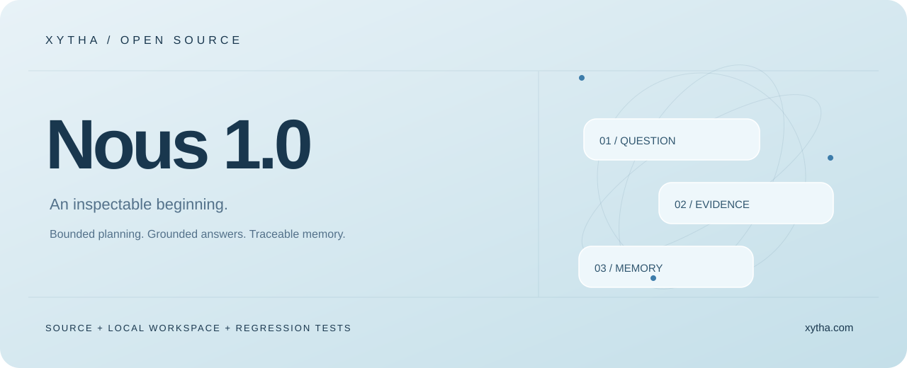
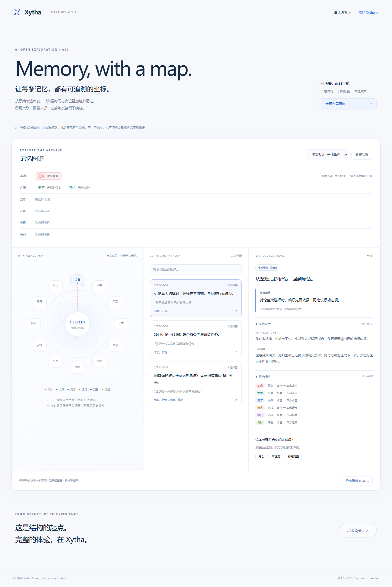

<p align="center"></p>
<h1 align="center">Xytha Open Source</h1>
<p align="center"><b>Grounded answers. Traceable memories.</b><br/>Henosis 1.0 · Nous 1.0 · Memory Atlas</p>
<p align="center"><a href="https://xytha.com">Explore Xytha ↗</a> · <a href="henosis-1.0/README.en.md">Henosis source & setup</a> · <a href="nous-1.0/README.en.md">Nous source & setup</a> · <a href="https://aiden-uamb.github.io/xytha-memory-atlas/">Atlas live demo</a> · <a href="README.md">中文</a></p>



Three independently runnable projects: **Henosis 1.0**, the original deep-analysis execution core; **Nous 1.0**, the first-generation agent system with a local host; and **Memory Atlas**, the dependency-free memory inspection playground.

## Henosis 1.0

Original planning, deterministic evidence, cross-period comparisons, bounded repair and resumable execution. Node.js 22.13 or newer:

```sh
git clone https://github.com/AIDEN-UAMB/xytha-memory-atlas.git
cd xytha-memory-atlas/henosis-1.0
npm ci
npm run build
npm run demo
npm test
```

The demo computes a synthetic chart without model calls. To run the complete analysis with your own provider, see [setup](henosis-1.0/README.en.md). [Source hashes](henosis-1.0/SOURCE-MANIFEST.json) distinguish original code from standalone host adapters. Henosis-2.0 is not included.

## Nous 1.0

Node.js 24 LTS:

```sh
git clone https://github.com/AIDEN-UAMB/xytha-memory-atlas.git
cd xytha-memory-atlas/nous-1.0
npm ci
npm run build
npm start
```

Open **http://127.0.0.1:4174**. Your own provider is optional; without one, the host returns deterministic chart facts. See the [guide](nous-1.0/README.en.md), [architecture](nous-1.0/docs/architecture.md), [provenance](nous-1.0/SOURCE-MANIFEST.json) and [scope](docs/scope.md).

Nous 1.0 streams progress and chunks a completed answer; incremental answer generation is not a feature of that package. Henosis 1.0 is published separately in `henosis-1.0/`. Nous 2.0, Henosis 2.0, private history, credentials and real user data are excluded. The local host is not a public authentication deployment. Astrological metadata is not verified predictive evidence.

## Memory Atlas



Inspect original conversations, authored summaries, six archived time layers, palace associations and append-only corrections. All sample people and conversations are synthetic. The static demo does not calculate charts or call models.

### Run Atlas

Use Node.js 22 or newer, download the repository and run:

```sh
npm run dev
```

Open **http://127.0.0.1:4173**. No install, account, API key or model call is needed. On PowerShell, use `npm.cmd` if script execution policy blocks `npm`.

Select “查看六层示例” to load an explicit example. Change a parent time node to clear descendants, click a palace to filter records, inspect the original conversation and add a correction. Switching a profile changes the visible archive. Feedback exists only in page memory; refreshing resets it. Exporting JSON includes any feedback you typed.

## Public components

- A six-level parent/child time tree with deselection and descendant reset.
- An interactive archived-tag map and exact metadata filtering.
- Source IDs, verbatim quotations and summaries displayed side by side.
- Append-only feedback that leaves original source text and archived tags intact.
- A JSON Schema, runtime validation, synthetic fixtures and tests.

Atlas is the **inspection layer**. The newly published `nous-1.0/` includes Nous orchestration, chart integration, prompts and its memory dependencies. Unpublished production components, user data and infrastructure secrets remain excluded.

## Research boundary

The repository has no user study, accuracy benchmark or measured personalization lift. It demonstrates a data model and inspectable interaction. The proposed use of palace overlays for preference retrieval is an unvalidated hypothesis. An honest evaluation needs temporal holdouts, user-confirmed relevance labels and ablations against semantic and randomized-tag baselines. See [the evaluation plan](docs/evaluation.md).

Fixture intervals are UTC, half-open intervals and deliberately simplified. Their stem-branch names are illustrative metadata, not calendrical calculations. Do not use the fixture data as chart facts.

## Develop

```sh
npm test
npm run check
npm run build
```

Deploy `dist/` to a static host, including a subdirectory. Runtime assets make no model or analytics calls. External links open only when selected. The public filter is deterministic metadata/text matching, without preference inference or ranking.

MIT licensed. The Xytha name does not imply endorsement of derivatives. Full product: [xytha.com](https://xytha.com).
