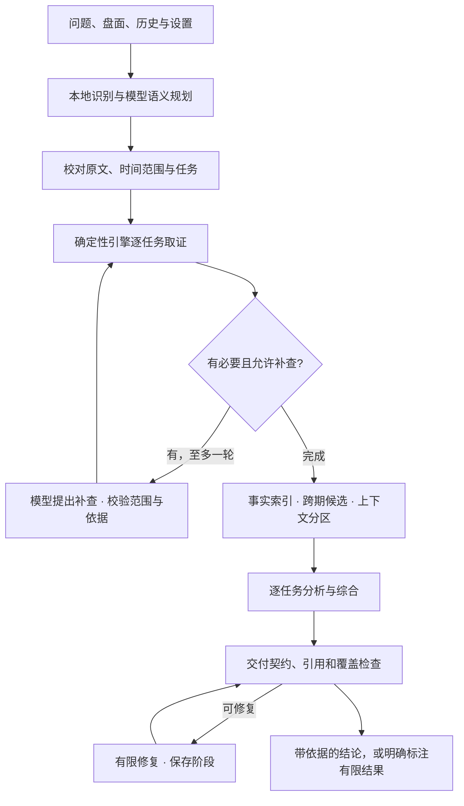

<p align="center"></p>
<h1 align="center">Henosis 1.0</h1>
<p align="center"><b>规划 · 取证 · 比较 · 综合</b><br/>Xytha 原版深度分析引擎，独立运行的源码发行版。</p>
<p align="center"><a href="https://xytha.com"><b>体验完整 Xytha ↗</b></a> · <a href="docs/architecture.md">架构与接口</a> · <a href="docs/testing.md">测试与版本边界</a> · <a href="README.en.md">English</a></p>
<p align="center"><a href="https://github.com/AIDEN-UAMB/xytha-memory-atlas/actions/workflows/henosis.yml"></a>  <a href="LICENSE"></a></p>

Henosis 把领域问题拆成有时间边界的任务，用确定性排盘引擎提取依据，再组织模型进行分层比较和综合回答。它是 **Agent 调度与证据系统**，不是自行训练的基础模型。

本目录公开原版 **`xytha-henosis.1` / `henosis-depth.10`** 的执行核心与运行依赖。版本号 1.0 是原版源码发行编号；不包含 Henosis-2.0。源码来源及宿主适配见 [哈希清单](SOURCE-MANIFEST.json)。

## 开始使用

需要 Node.js 22.13 或更新版本、npm。

```sh
git clone https://github.com/AIDEN-UAMB/xytha-memory-atlas.git
cd xytha-memory-atlas/henosis-1.0
npm ci
npm run build
npm run demo
```

`demo` 对合成人物生成十二宫数据，**不调用模型、不生成分析结论**。要验证完整规划和回答链，运行离线模拟回归：

```sh
npm test
npm run check
```

## 连接自己的模型

1. 将 `.env.example` 复制为 `.env`，填写服务商 HTTPS 地址、模型名、密钥及真实上下文容量。
2. 将 `examples/input.json` 复制到自行建立的 `private-inputs/input.json`，修改出生信息、问题和调查日期。
3. 运行：

```sh
npm start -- private-inputs/input.json
```

支持 `openai-chat`、`openai-responses`、`anthropic`、`gemini` 四种协议；具体模型的结构化输出能力会影响结果。`HENOSIS_JSON_MODE` 仅在服务商支持时开启。PowerShell 如限制 npm 脚本，请用 `npm.cmd`。

CLI 把必要问题、盘面和分析资料发送给你选择的服务商；使用服务商的额度。密钥从本地环境读取，错误输出不包含密钥或原始请求。请勿提交 `.env`、私人命盘或对话。

退出码：`0` 表示回答完成或排盘演示成功；`2` 表示得到有限/未完整交付结果；`1` 表示输入或执行失败。CLI 检查点仅存在本次进程内，退出后不保留。持久化恢复需自行接入 `load/save`，见 [接口说明](docs/architecture.md)。

## 工作流



| 模块 | 原版行为 |
| --- | --- |
| 任务规划 | 本地快速识别配合模型语义规划，按原文绑定任务与时间边界 |
| 取证 | 本命、大限、流年、流月、流日，提取相关宫位、星曜和四化 |
| 深度分析 | 历史大限对照、候选区间比较、关联任务整合 |
| 上下文 | 结构化别名和表格压缩、超容量分区，保留候选与事实引用 |
| 交付 | 结构化草稿、依据检查、有限修复、可追踪限制 |
| 恢复与用量 | 阶段检查点、结果重用、实际与估算 token 分开记录 |

## 原版边界

- 保留原版规划器、提示词、证据计算、审核策略及预算，不把 2.0 功能倒填成 1.0。
- 原版分析契约支持五层；本包不宣称支持完整流时分析。
- 原版默认历史大限数为 2，可选 1–3；补查为 0–1 轮。内部还有最多 32 次模型请求、30 分钟软期限、300,000 token 的预算，具体行为以源码为准。
- 阶段进度可通过 `onProgress` 获取；正文完成后返回，不宣称逐 token 正文生成。
- 本包包含可运行执行核心；网站界面、生产账号认证、数据库、部署配置和私人数据不包含在内。CLI 为独立宿主，不是完整官网。
- 合成回归验证工程行为，不证明专业判断准确率，也不证明优于其他模型。盘面计算与传统解释、现实事实应分别评估。

## 源码地图

```text
lib/henosis-plan.ts          任务与补查规划
lib/henosis-evidence.ts      逐层证据收集
lib/henosis-runtime.ts       原版协调执行器
lib/henosis-context.ts       模型输入与证据包
lib/henosis-answer.ts        交付格式、审核与呈现
lib/henosis-recovery.ts      分任务恢复与合并
lib/henosis-efficiency.ts    分区、编码与修复范围
lib/providers/              模型协议、传输与错误处理
lib/chart.ts                确定性排盘入口
runtime/exports.ts          独立包接口
tests/                      离线工程回归
```

[MIT License](LICENSE) · [第三方依赖](THIRD-PARTY-NOTICES.md) · [Xytha 开源首页](../README.md)
