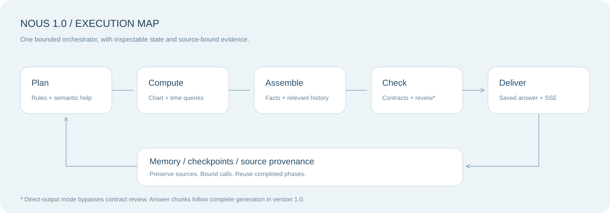
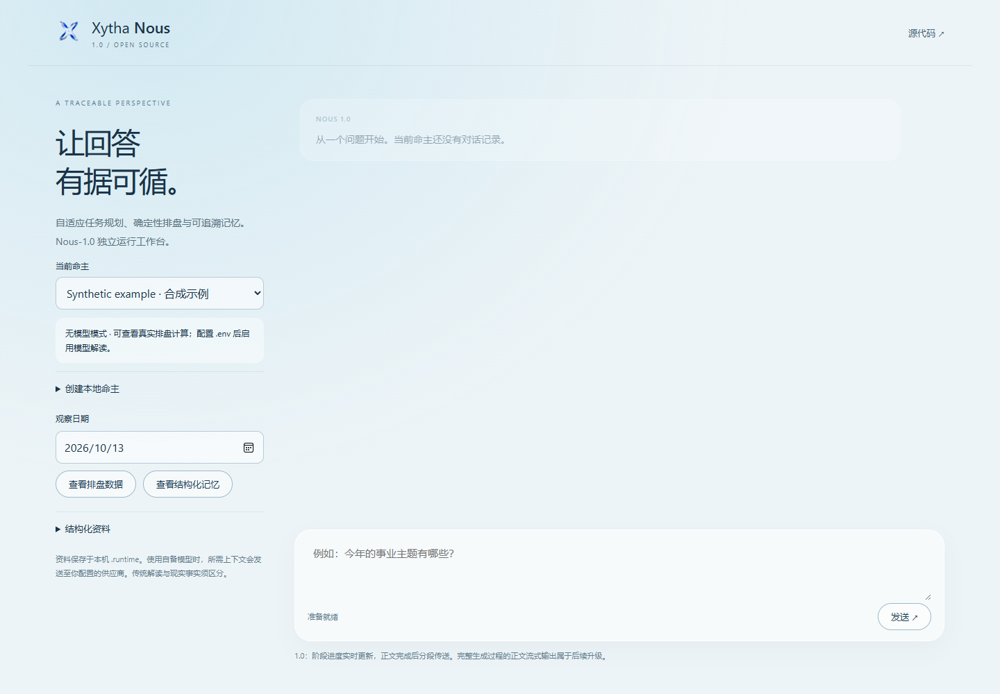

<p align="center"></p>
<h1 align="center">Nous 1.0</h1>
<p align="center"><b>从问题到依据，从对话到记忆。</b><br/>A bounded domain agent. An inspectable first-generation baseline.</p>
<p align="center"><a href="https://xytha.com">体验 Xytha ↗</a> · <a href="README.en.md">English</a> · <a href="docs/architecture.md">架构</a> · <a href="docs/running.md">运行指南</a> · <a href="docs/version-boundary.md">版本边界</a></p>

**这是 Xytha-Nous 第一代执行系统的完整独立运行源码。** 原有规划、排盘、取证、上下文装配、模型适配、回答校验、记忆处理、请求租约与检查点恢复均包含在内；另附一个本地浏览器工作台。它是可运行的版本基线，不是只展示接口的示例或即将实现的 Nous-2.0。



<details><summary>查看本地工作台实际截图（合成命主，无模型模式）</summary>



</details>

## 五分钟开始

使用 **Node.js 24 LTS**。从仓库根目录执行：

```sh
cd nous-1.0
npm ci
npm run build
npm start
```

打开 **http://127.0.0.1:4174**。PowerShell 如阻止 `npm.ps1`，使用 `npm.cmd`。启动后可创建命主、查看排盘 JSON、提问并读取本机历史。

**不配置密钥：** 使用确定性排盘与规则回答，不会调用模型。预置人物为合成示例，不能作为真实研究数据。

**使用自己的模型：** 将 `.env.example` 复制为 `.env`，填入 `NOUS_API_KEY`、`NOUS_MODEL`，核对 `NOUS_BASE_URL` 与 `NOUS_PROTOCOL`，重启服务。支持 OpenAI Chat 兼容、Responses、Anthropic、Gemini 协议；具体模型可用性与计费由供应商决定。不会读取机器上无关的 `OPENAI_API_KEY`。

本机密钥只在服务端读取；浏览器提交的模型地址、密钥和身份字段会被忽略。模型所需的出生信息、问题、历史及相关记忆会发送给你选择的供应商。

## 已包含什么

| 组件 | 源码 | 行为 |
| --- | --- | --- |
| 对话入口 | `app/api/chat/route.ts` | 请求约束、命主版本、历史读取、保存、SSE 与续接 |
| 规划与执行 | `lib/analysis-plan.ts`、`lib/analysis-runtime.ts` | 主题与时期识别，共享调查、证据去重 |
| 排盘与时期 | `lib/chart.ts`、`lib/timing*.ts` | 确定性计算，时间区间与来源绑定 |
| 交付契约 | `lib/bprime/` | 事实注册表、边界、引用校验、复核与局部恢复 |
| 模型适配 | `lib/providers/` | 多协议、输出解析、超时与调用信息 |
| 结构化记忆 | `lib/palace-memory*.ts` | 原文引用、宫位与时间关联、概述、纠正和检索 |
| 执行恢复 | `lib/chat-runs.ts`、`lib/chat-checkpoint.ts` | 请求去重、租约、已完成调用的阶段重放 |
| 本地宿主 | `runtime/`、`deployment/database.mjs` | Node SQLite 适配、回环地址服务、合成起始资料 |
| 回归 | `tests/` | 合成排盘、规划、契约、上下文、记忆、协议和本地运行 |

## 查看记忆

成功的模型对话会由原有入口排入记忆任务。整理概述需要调用模型，采用显式命令，方便控制费用：

```sh
npm run memory:process
```

每次命令最多处理每个命主的一项待处理任务。完成后点击工作台「查看结构化记忆」。没有配置模型、任务尚未处理或没有相关卡片时，记忆面板为空是正常状态。原始对话与整理结果是不同的数据。

## 1.0 的真实边界

- 一个有界协调流程管理多个步骤，不是自主多 Agent 群体。
- 当前模型分析 `Scope` 覆盖本命、大限、流年、流月、流日。Atlas 演示的流时标签不代表这条 Nous 分析链已经支持流时查询。
- 阶段进度使用 SSE；**回答完整生成后才切块发送正文**。端到端的逐段生成流属于待讨论的 Nous-2.0。
- 默认启用现有契约流程。`XYTHA_DIRECT_OUTPUT=true` 会跳过结构及证据契约审核；直接输出不能标记为已复核。
- 校验通过表示满足软件契约，不证明命理预测或人格推断科学有效。现实事实和用户更正优先。
- 缓存、预算和恢复均有边界。检查点不能保证供应商请求在任意崩溃时刻都恰好计费一次。
- 本地工作台是单用户宿主。没有生产 Supabase 账号系统，不要直接暴露到公网。

## 验证与来源

```sh
npm run build
npm run typecheck
npm test
npm run check
```

回归使用合成数据与模拟模型，不调用付费模型、不报告真实模型质量或吞吐量。`SOURCE-MANIFEST.json` 记录导出文件的 SHA-256，以及唯一的历史协议依赖适配；核心算法文件保持导出时内容。新增宿主、工作台、文档和打包工具属于本次开源包装。

[版本说明](docs/version-boundary.md)明确列出与线上产品的差异。[测试说明](docs/testing.md)说明覆盖范围与限制。贡献前请阅读仓库根目录的 [CONTRIBUTING](../CONTRIBUTING.md) 与 [SECURITY](../SECURITY.md)。

MIT 许可适用于本目录发布的原创代码，见 [LICENSE](LICENSE)。Henosis、Nous-2.0、线上账号和部署资料、用户数据及私有 Git 历史不在此发行包中。依赖保留各自许可证，见 [THIRD-PARTY-NOTICES](THIRD-PARTY-NOTICES.md)。
