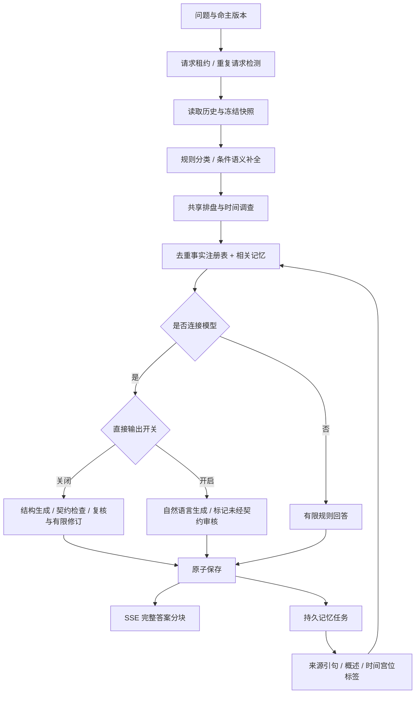

# Nous 1.0：架构与执行边界

Nous 是一个由程序编排的领域 Agent。模型负责有限的语义补全、解释与复核；排盘计算、来源绑定、请求身份与恢复由软件执行。

`analysis-runtime.ts` 共享 chart reader，将多个任务的证据去重后交给一次主要回答流程；子问题数量不直接等于模型调用数量。存在歧义时才走语义补全。模型审查与修订仍可能增加调用。

`workflow-phase.ts` 冻结模型调用签名与结果。重放必须与签名一致，已保存的阶段无需再请求模型。`chat-runs.ts` 对请求标识、命主、指纹和并发租约作约束。`chat-checkpoint.ts` 加密保存阶段快照。供应商已执行但结果尚未持久化的失败窗口不能由本机制证明“恰好一次计费”。

`palace-memory.ts` 校验概述中的引句是否存在于原话，关联命主版本、来源消息与时间宫位坐标。用户假设不能直接写成真实经历；更正会影响后续检索。记忆只是上下文，不替代确定性盘面。

公开包装层通过 esbuild 将 `cloudflare:workers` 绑定指向 Node SQLite 适配，保留原始核心代码。原始 `owner()` 依赖可信身份头；本地服务器拒绝跨站请求，并自行注入固定本地身份。直接把原始 route 挂到公网并信任客户端身份头是不成立的部署方式。

这不是模型权重发行、分布式任务集群、端到端逐 token 回答流或 Nous-2.0。源码开放允许检查实际路径，不能替代线上评测和安全审计。
